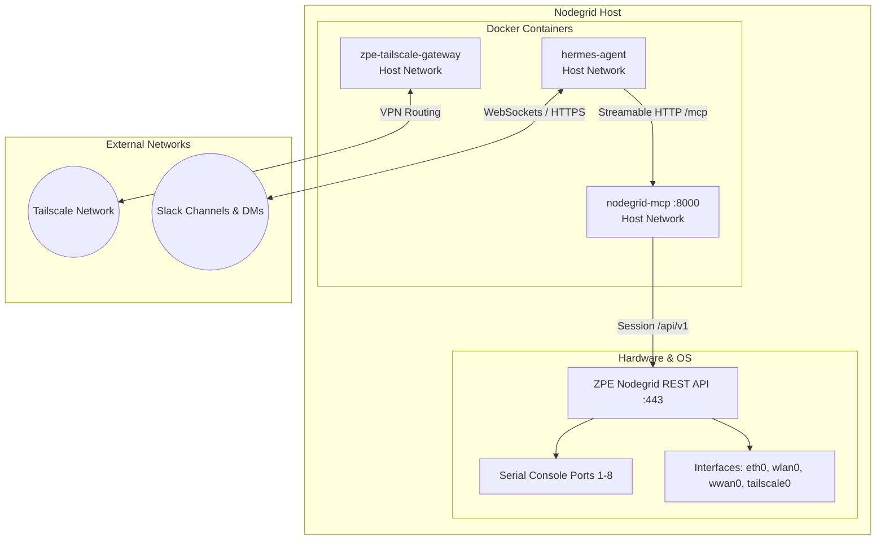

# Architecture Documentation: rina-zpe

## System Context

Nodegrid appliances function as serial console terminal servers and edge network appliances. The `rina-zpe` project integrates an autonomous AI operator (`hermes`) directly into the appliance, supervised via Slack and augmented by a local read-only Model Context Protocol (MCP) gateway.

## Container Network Architecture

All containers operate in `network_mode: host`:
- **`zpe-tailscale-gateway`**: Manipulates host routing tables via `/dev/net/tun` with `NET_ADMIN` privileges. Advertises subnet routes so remote operators can reach appliances without port forwards.
- **`nodegrid-mcp`**: Binds to `0.0.0.0:8000` (or `127.0.0.1:8000`). Communicates with the Nodegrid REST API on `https://127.0.0.1:443`.
- **`hermes`**: Connects via loopback `http://127.0.0.1:8000/mcp` directly to `nodegrid-mcp`, minimizing external interface exposure.

## Security Considerations

1. **Local-Only MCP Binding**: The MCP server is meant for internal consumption by the agent. No sensitive authentication endpoints are exposed publicly.
2. **Read-Only Telemetry by Default**: The standard `nodegrid-mcp` exposes read operations (`get_network_interfaces`, `list_managed_devices`, `get_cellular_status`). Serial port write operations (dances) are kept in standalone audited scripts.
3. **Session Ticket Hygiene**: REST API tickets are maintained in memory and never persisted to disk.
